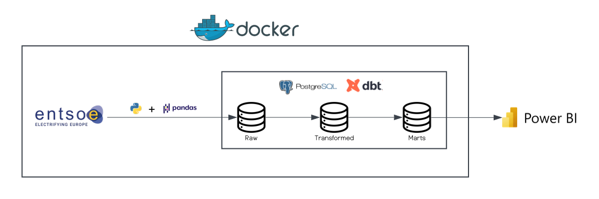
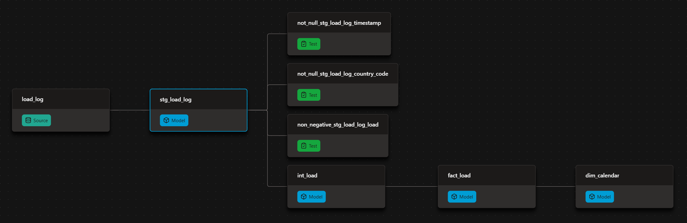
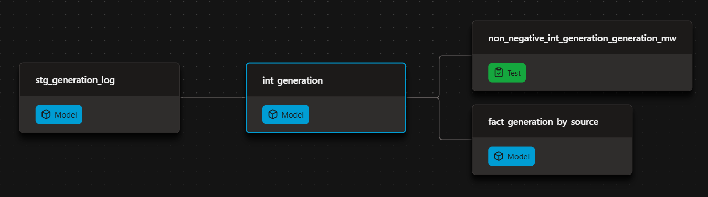
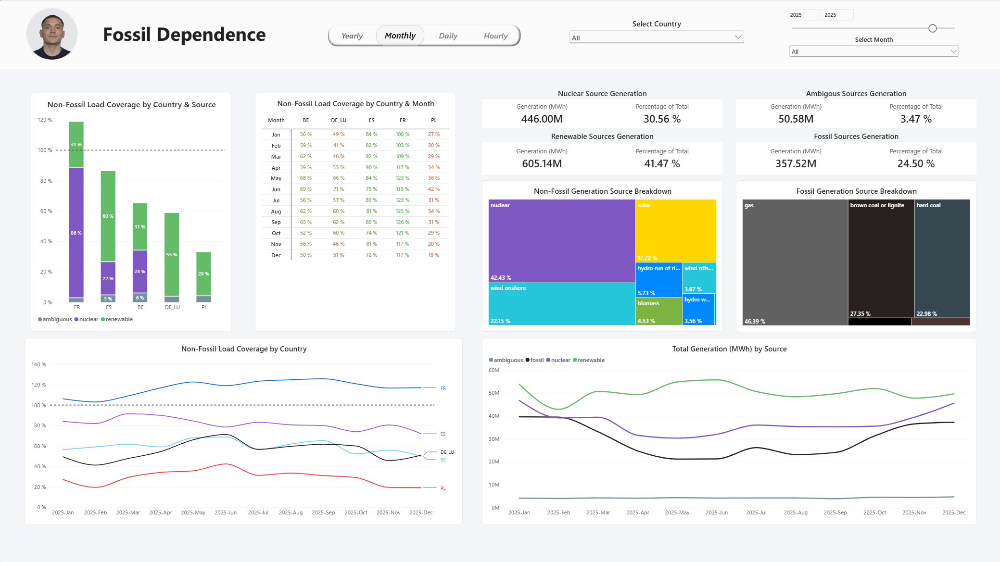
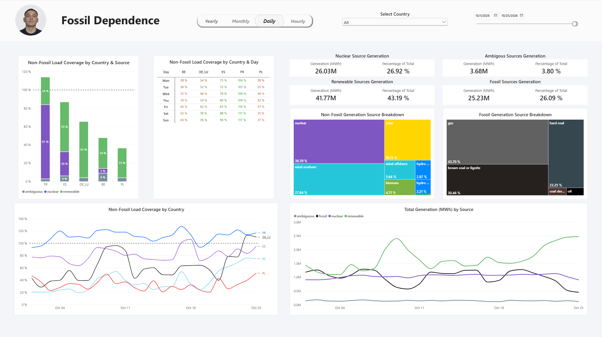
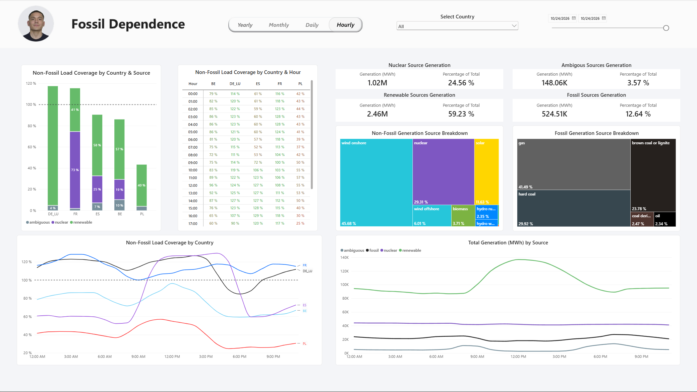

# ⚡ European Fossil Dependence

**How much of each country's electricity demand could be covered by its own non-fossil generation alone?**

An end-to-end data engineering and analytics project covering **Spain, France, Belgium, Germany/Luxembourg and Poland**. It pulls hourly generation and load data from the ENTSO-E Transparency Platform (2019 → today), models it with dbt on PostgreSQL, and serves it through an interactive Power BI report.


> 📚 **[Browse the dbt documentation & lineage](https://placeholder_for_dbt_documentation)**

---

## What the data says

A few things that jump out of the dashboard (2019 – 2026 year to date):

- 🇫🇷 **France is the outlier.** Its nuclear fleet plus renewables cover roughly 100%+ of its own load in most years, reaching ~116% in 2025.
- 🇵🇱 **Poland is the most fossil-dependent** of the five, but non-fossil coverage has climbed steadily from ~11% (2019) to ~32% (2026 YTD).
- 🇪🇸 **Spain has made the biggest sustained gain**, from ~61% to ~84%, thanks to a fast increase in renewable generation.
- 🇩🇪 **Germany/Luxembourg has been flat at ~55–60%** across the whole period.
- 🇧🇪 **Belgium drops from ~80% (2021) to ~41% (2026 YTD)**, the sharpest decline in the set. The cause is the phase-out of its nuclear fleet, whose generation is now virtually zero.
- Across all countries and years, generation splits roughly into **37% renewable, 31% nuclear, 29% fossil, 3% ambiguous**.

### How coverage is calculated

**Non-fossil load coverage = (nuclear + renewable generation) ÷ load**, per country and period. Values above 100% mean a country generates more non-fossil electricity than it consumes, so the surplus could be exported.

Generation sources are grouped into four categories: **nuclear**, **renewable**, **fossil**, and **ambiguous**. Ambiguous sources can't be clearly labeled as fossil or non-fossil, so they are shown in the report but counted in neither side of the calculation.

ENTSO-E reports some zones at 15-minute resolution. These readings are aggregated to hourly values in the intermediate layer, so every country shares the same grain.

Because the report goes all the way down to hourly resolution, you can also see *when* a country leans on fossil fuels: solar-driven midday peaks, overnight dips, and weekday vs. weekend patterns.

---

## Architecture



I chose an **ELT** approach to decouple ingestion from modeling: Python only extracts and loads raw data, and all business logic lives in SQL where it can be tested and documented. Everything except Power BI runs in Docker containers for a reproducible environment.

| Layer | Tool | Role |
|---|---|---|
| Source | [ENTSO-E Transparency Platform](https://transparency.entsoe.eu/) | Generation per source type and total load, per bidding zone |
| Extract & Load | Python, pandas, `entsoe-py`, SQLAlchemy | Pull from the API, clean up the response shape, load raw into Postgres |
| Storage | PostgreSQL 16 | Warehouse (`staging` schema for raw data, dbt-managed models on top) |
| Transform | dbt | Staging → intermediate → marts, with tests and docs |
| Serve | Power BI | Interactive report on top of the marts |
| Infra | Docker Compose, VS Code Dev Containers | Postgres, extractor/dbt runner and an optional pgAdmin |

**About the source:** ENTSO-E is the European Network of Transmission System Operators for Electricity. It brings together 40 operators from 36 countries to promote the internal electricity market and the secure operation of the European grid.

---

## Data model

dbt builds a three-layer project with a star-schema mart at the end:

```
sources            staging                intermediate        marts
────────           ────────────────       ────────────        ───────────────────────────
generation_log ──▶ stg_generation_log ──▶ int_generation ──▶ fact_generation_by_source ─┐
                                                                                          ├─▶ dim_calendar
load_log       ──▶ stg_load_log       ──▶ int_load       ──▶ fact_load ─────────────────┘
```

Data quality is enforced with dbt tests that run as part of `dbt build` (e.g. `not_null` on timestamps and country codes, `non_negative` on load and generation values). If a test fails, the build tells you before bad numbers reach the dashboard.

<details>
<summary><b>Lineage graphs (from the dbt docs)</b></summary>

<br>

**Load**



**Generation**



</details>

---

## Dashboard

Interactive filtering by **country**, **date range**, and **time granularity** (yearly, monthly, daily, hourly).

**Left side: self-sufficiency**
Three visuals showing how much of each country's electricity load non-fossil sources could cover: a stacked bar by source, a country × period coverage matrix (colour-coded, with the 100% line as reference), and a coverage time series.

**Right side: generation & fuel mix**
Total generation by source category over time, KPI cards for nuclear / renewable / fossil / ambiguous generation, and treemaps that break down the non-fossil and fossil mixes by individual source (wind onshore, solar, gas, hard coal, …).

<details>
<summary><b>See the other granularities</b></summary>

<br>

**Monthly**



**Daily**



**Hourly**



</details>

---

## Engineering notes

A few decisions worth calling out:

- **Idempotent runs.** Each run recreates the `staging` schema from scratch, so the pipeline can be re-executed at any time and always ends in a consistent state.
- **Messy API responses handled explicitly.** ENTSO-E returns generation as a multi-level column frame with both *Actual Aggregated* and *Actual Consumption* series, and some source types appear more than once. A normalization step keeps only aggregated generation, flattens the columns and merges duplicates (first non-null value wins).
- **Schema that adapts to the data.** Generation source types vary by country, so the loader adds any missing source column to the staging table on the fly instead of hard-coding a fixed list.
- **Fault isolation per country.** A failed API call for one country is logged and skipped rather than aborting the whole run.
- **Orchestrated end to end by one script.** `app.py` sets up the database, extracts, loads, and then invokes `dbt build` programmatically, so a single command takes you from empty database to fresh marts.

---

## Project structure

```
.
├── app.py                 # Extract & load from ENTSO-E, then triggers dbt
├── compose.yaml           # Postgres, extractor/dbt runner, optional pgAdmin
├── requirements.txt
├── fossil_dependence.pbix # Power BI report
├── dbt/
│   ├── models/
│   │   ├── staging/       # Light cleanup of raw tables
│   │   ├── intermediate/  # Business logic, source classification
│   │   └── marts/         # fact_generation_by_source, fact_load, dim_calendar
│   ├── macros/ seeds/ tests/
│   ├── dbt_project.yml
│   └── profiles.yml
├── docs/                  # dbt documentation
└── images/                # Diagrams and dashboard screenshots
```

---