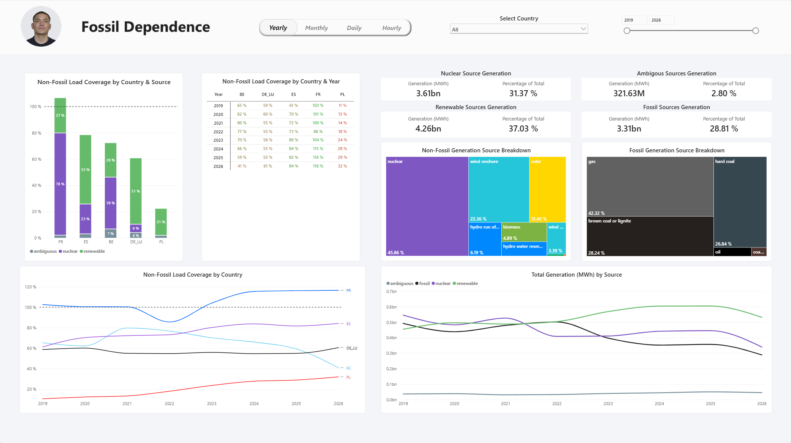

# ⚡ European Fossil Dependence

**How much of each country's electricity demand could be covered by its own non-fossil generation alone?**

An end-to-end data engineering and analytics project covering **Spain, France, Belgium, Germany/Luxembourg and Poland**. It pulls hourly generation and load data from the ENTSO-E Transparency Platform (2019 → today), models it with dbt on PostgreSQL, and serves it through an interactive Power BI report.

> 📚 **[Browse the dbt documentation & lineage](https://placeholder_for_dbt_documentation)**

---

